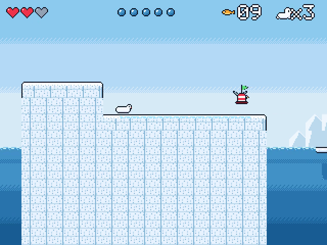
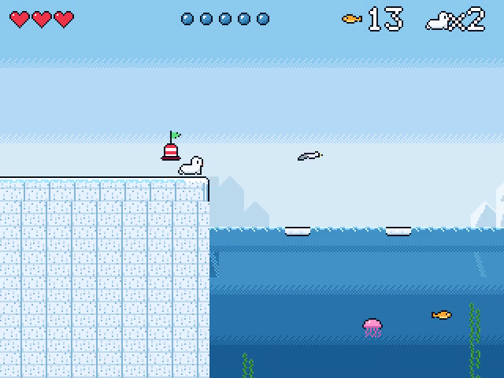
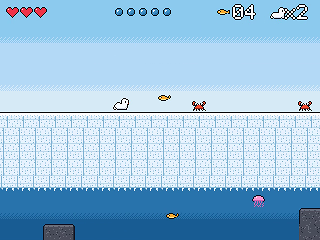

# Tidepup

Help a seal pup bring fish home across four shores. The pup is slow on land and fast in the water; a strong upward swim can launch it onto the ice.

For the Zeal 8-bit computer with the Video Board, running Zeal 8-bit OS.

  

## Controls

Menu prompts default to a connected SNES pad and follow the last device used
in the menu. The selected keyboard/pad display stays fixed during the game.

| Action | Keyboard | SNES pad |
|---|---|---|
| Galumph on land, swim in 8 directions | Arrows | D-pad |
| Jump on land, flipper kick in water | Z or Space | B |
| Belly slide | X | A |
| Pause | Enter | Start |
| Quit to title | Right Shift | Select |

Enter starts the game on the title screen.

## How to play

- Explore the shore, collect fish and bring them home.
- Swim and kick to gain speed. Build enough upward speed to leap out of the water.
- Avoid enemies and use the terrain to cross each shore.

## Build

Install the Zeal Development Environment (ZDE) and its SDK dependencies, then run
these commands from this repository:

```sh
zde deps install zgdk
zde deps install zar
zde cmake
```

The build produces `bin/tidepup.bin` and `bin/tidepup.zar`.
Use a current ZGDK installation with inertial-controller support.

## Run

For Zeal-NativeEmulator, mount the output folder as HostFS:

```sh
zeal-native -r /path/to/os_with_romdisk.img -H bin
```

At the ZOS prompt:

```text
cd H:/
exec tidepup.bin
```

On hardware, copy the `.bin` and `.zar` together and run the game from that folder.

Build variants, asset editing and optional development tools are documented in
[the development guide](docs/development.md).

## License

Copyright 2026 David Higgins. Game code and original assets are licensed under
[Apache License 2.0](LICENSE). External SDKs and tools retain their own licenses.
